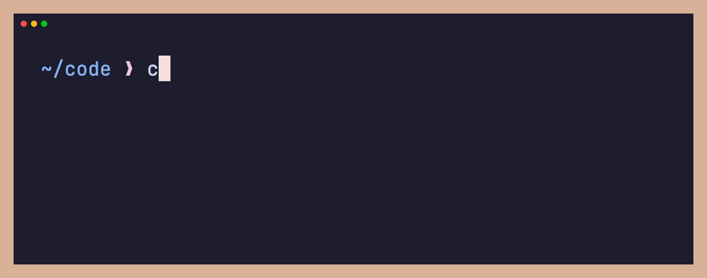

<p align="center"></p>

<h1 align="center">usual</h1>

<p align="center"><b>No more staring at your terminal like "can I get uhh…"</b><br><code>cd</code> in. Your usual is already there.</p>

<p align="center">zsh · macOS · Linux</p>



Reads `package.json`, `justfile`, `Makefile`, Cargo, Go, Python, mise, Compose and more. Learns what you run. Runs nothing by itself. No network.

## Install

### curl

```bash
curl -fsSL https://raw.githubusercontent.com/karlcode/usual/main/install.sh | sh
```

### brew

```bash
brew install karlcode/tap/usual && echo 'eval "$(usual init zsh)"' >> ~/.zshrc
```

## Keys and settings

| Key | Does |
|---|---|
| <kbd>Tab</kbd> | take |
| <kbd>↓</kbd> <kbd>↑</kbd> | next, back |
| type | hide |

Change any of it in `~/.zshrc`:

```bash
USUAL_TAB=run               # Tab runs it. No Enter.
bindkey '^F' usual-accept   # Ctrl-F instead of Tab
bindkey '^N' usual-next     # Ctrl-N instead of ↓ (also usual-previous, usual-dismiss)
USUAL_HINT=enter            # hint only right after cd (off: never)
USUAL_TYPING=off            # no list while typing
USUAL_ROWS=1                # rows shown (default 4)
USUAL_COMMAND_STYLE=244     # colour (also USUAL_DESCRIPTION_STYLE, USUAL_KEY_STYLE)
```

## More

- `usual` lists, `usual | fzf` picks, `usual --json` for scripts.
- Works with oh-my-zsh, powerlevel10k, starship, zsh-autosuggestions, fzf-tab, atuin, vi mode and [more](scripts/compat.py).
- Order: missing setup, your habits, the README, then names. Risky last.
- Uninstall: `rm ~/.local/bin/usual`, delete the `usual` line in `~/.zshrc`.
